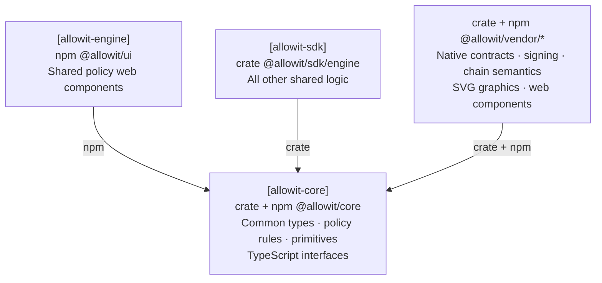

# Allowit core

Allowit core contains portable policy rules and reusable host primitives.
The shared SDK engine composes those primitives for both CLI and server hosts.
Rail libraries own native requests, codecs, signing and finality.
The server adds its exclusive policy authority and private state.

## Architecture

SDK core owns common types, policy rules, primitives and TypeScript interfaces.
SDK engine, vendor packages and shared web components depend on these common contracts.



[Full architecture][responsibility-model].

## Packages

| Package | Library | Responsibility | License |
| --- | --- | --- | --- |
| `allowit` | `allowit` | Deterministic policy types, nine rules, evaluation and accounting | `UNLICENSED` |
| `allowit-sdk` | `allowit_sdk` | Generic owner capabilities, private storage, configuration, source checks and bounded transport | MIT |
| npm `@allowit/core` | `@allowit/core` | Common wire types and canonical function metadata for frontends | MIT |

[Dependency checks](scripts/check_core_boundaries.py) reject declared and locked native rail dependencies, including hidden optional or target declarations.
Core depends on no other Allowit repository. Rails, vendor adapters and SDK engine can use its
admitted package profiles directly. Importing a library grants no signing or payment authority.

`allowit` defaults to its `std` evaluator and uses chain-neutral Rust values.
Denials and panics discard policy writes. The crate has no rail SDK dependency.
Rails own native contract types, storage bindings and execution profiles, along with custody,
native transaction encoding and native receipt checks.

`allowit-sdk` defaults to `std`. Its `admin` capabilities and exact-byte `digest` also build without
`std`. Host-only features expose these modules:

| Feature | Modules |
| --- | --- |
| `client` | Private atomic storage, configuration, errors, journals and output |
| `service` | Protocol-neutral RPC operation contracts |
| `transport` | Bounded blocking HTTP/JSON-RPC. Enables `service` |
| `policy-source` | Portable authored-source allowlist and shape checks. Selects the portable `std` backend |

RPC endpoints require HTTPS or loopback HTTP, without URL credentials or fragments.
Transport performs one attempt. The calling workflow chooses recovery using the original signed
operation. A failed response does not establish transaction failure.

The host-only `policy_source::source_shape` derives the canonical prefix and detects state writes.
It rejects source constructs outside the portable allowlist. It grants no publication or admission
authority. Stellar binds that shape to its native wallet tier. The server enforces trusted admission.

`scripts/policy_source.py` provides the corresponding Python gate and direct-rustc host compile.
The `policy_source` module embeds that helper, its terms and the portable source bytes from the
selected dependency release. SDK engine can unpack them into a private directory for its bounded
build process. The portable package exports its own bytes only in the `std` profile.
Source-based build hosts can also resolve both files from the same verified Core release.
Do not substitute a sibling checkout or a helper selected through an environment variable.
The source gate and host compile are separate required checks before trusted publication.

## Common policy interfaces

Rust callers enable `policy-source` and use `allowit_sdk::policy`.
`PolicyValue` is a JSON wrapper around the existing portable value.
Its five tags are `Int`, `Bool`, `Str`, `Addr` and `List`. Integers use canonical decimal strings.
Address text remains opaque. Native adapters check native identities.
This codec does not replace parameter, source, installation or authority validation.

JavaScript and TypeScript callers import `@allowit/core`.

```ts
import { canonicalFunctions, type PolicyValue } from "@allowit/core";
const limit: PolicyValue = { Int: "9007199254740993" };
```

[Function metadata](typescript/canonical-functions.json) supplies common descriptions, second-argument shapes and semantic types.
Amount metadata assumes no asset, decimals or price normalization. Hosts and native adapters supply verified unit context.
Registry order does not prescribe source order. SDK engine derives source bindings and workflow projections.
The exported metadata hash identifies the exact JSON bytes shared by Rust and JavaScript.

Use `pnpm install --frozen-lockfile --ignore-scripts` for its development tools.
Run `pnpm generate` after changing the registry. `pnpm check` detects stale generated exports.
`pnpm test` checks a packed public consumer and the Rust/JavaScript integer roundtrip.
The npm archive contains interfaces, metadata, runtime exports and MIT terms. It excludes portable guest source.

## Dependencies and releases

Every package in this repository releases the same annotated tag `vX.Y.Z`.
Consumers name a published tag and its minor version, and commit `Cargo.lock`.
For a version 0.3.1 release, the dependency declarations are:

```toml
allowit = { git = "https://github.com/allowit-hq/allowit-core.git", tag = "v0.3.1", version = "0.3", default-features = false, features = ["std"] }
allowit-sdk = { git = "https://github.com/allowit-hq/allowit-core.git", tag = "v0.3.1", version = "0.3", default-features = false, features = ["client", "transport"] }
```

All Allowit packages in one build name the same core tag.
Version 0.3 removes the `soroban` feature and the `allowit::soroban` module.
`allowit-contracts-stellar` must provide its native binding before adopting this release.
Existing consumers pinned to version 0.2 retain their immutable source and contract behavior.
Host consumers can retain `default-features = false, features = ["std"]`.
The shared `allowit-sdk` package still supports its minimal `no_std` profile.
The policy evaluator requires `std` for panic containment and synchronized write buffers.

Set the workspace version, merge the reviewed release, then annotate the merge commit with that tag.
Never move an existing tag. Registry publication is a separate operation.

## Build and test

Use Rust 1.98 with rustfmt and Clippy.

```sh
cargo build --locked --workspace --all-targets
cargo fmt --all --check
cargo test --locked -p allowit-sdk --features client,service,transport,policy-source
cargo clippy --locked -p allowit-sdk --all-targets --features client,service,transport,policy-source -- -D warnings
cargo test --locked -p allowit
cargo test --locked -p allowit --no-default-features --features std
python3 -m unittest discover -s scripts/tests
python3 scripts/check_core_boundaries.py
```

[CI](.github/workflows/ci.yml) also checks default and explicit `std` policy profiles with Clippy
and the minimal host package. The policy library links into its caller.
Each rail checks its native contract build in its own repository.

The dependency guard checks Cargo declarations, the lockfile and declared npm manifests without running package-manager hooks.
It rejects local metadata paths outside Core. Local npm dependencies must be directories with regular package manifests.
Npm archives and opaque remote sources are not permitted.
Pnpm workspace files support a static `packages` list with relative paths and shallow globs. Unsupported YAML produces an error.

## Source and terms

The portable package originates in [the Stellar policy library][portable-source].
The retired compiler and bounded legacy model remain in [core's original source][legacy-source].

The host package, including the Rust source gate from Stellar's MIT host crate, uses the
[MIT License](LICENSE). The portable package declares `UNLICENSED` in
[its manifest](crates/allowit/Cargo.toml). The copied Python helper and corpus generator retain their
original undeclared terms under [scripts/LICENSE](scripts/LICENSE).
The original corpus and portable fixture retain their terms under [tests/fixtures/LICENSE](tests/fixtures/LICENSE).
Dependencies retain their own terms.

[portable-source]: https://github.com/allowit-hq/allowit-contracts-stellar/tree/d0ae9be9e3d7a51e9ac4a1008ba207937aef36a2/crates/allowit
[legacy-source]: https://github.com/allowit-hq/allowit-core/tree/64ec4e989b878b13995c139832a5901e92b020fd

[responsibility-model]: https://github.com/allowit-hq/allowit-project/blob/main/wiki/allowit/architecture.md#dependency-direction
