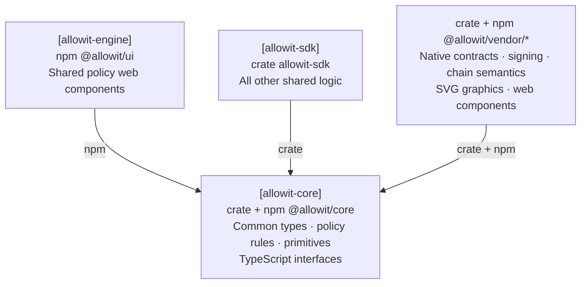

# Allowit core

Allowit core contains portable policy rules and reusable host primitives.
The shared SDK engine composes those primitives for both CLI and server hosts.
Rail libraries own native requests, codecs, signing and finality.
The server adds its exclusive policy authority and private state.

## Architecture

SDK core owns common types, policy rules, primitives and TypeScript interfaces.
SDK engine, vendor packages and shared web components depend on these common contracts.



## Packages

| Package | Library | Responsibility | License |
| --- | --- | --- | --- |
| `allowit-core` | `allowit_core` | Portable policy rules and reusable host primitives | [Per-file terms](crates/allowit-core/LICENSES.md) |
| npm `@allowit/core` | `@allowit/core` | Common wire types and canonical function metadata for frontends | MIT |

[Dependency checks](scripts/check_core_boundaries.py) reject declared and locked native rail dependencies, including hidden optional or target declarations.
Core depends on no other Allowit repository. Rails, vendor adapters and SDK engine can use its
admitted package profiles directly.

`allowit-core` defaults to its `std` evaluator and uses chain-neutral Rust values.
Denials and panics discard policy writes. The crate has no rail SDK dependency.
Rails own native contract types, storage bindings and execution profiles, along with custody,
native transaction encoding and native receipt checks.

The crate defaults to `std`. Its `admin` capabilities and exact-byte `digest` also build without
`std`. Host-only features expose these modules:

| Feature | Modules |
| --- | --- |
| `client` | Private atomic storage, configuration, errors, journals and output |
| `service` | Protocol-neutral RPC operation contracts |
| `transport` | Bounded blocking HTTP/JSON-RPC. Enables `service` |
| `policy-source` | Portable authored-source allowlist and shape checks. Selects the portable `std` backend |
| `vendor` | Host provider traits, common inputs, opaque native packets, signer capabilities and bounded client helpers |

The optional `vendor` feature exposes `allowit_core::vendor` for rail libraries and the SDK engine.
It enables the existing host client, transport and source features. It does not affect minimal builds.
Native packets retain their exact JSON bytes and carry an opaque in-memory capability plus their
provider's validation callbacks. SDK consumers restore records through their selected native adapter.
Core does not decode native packets or select a rail. Native signature rules remain in rail libraries.

The shared owner-session helper bounds HTTP authentication and keeps its cookie private.
The shared input helper bounds file ingress and JSON decoding. These helpers let native clients keep
the same constructors and input APIs without depending on the SDK engine.
The SDK engine retains profile caches, routing, execution orchestration and restart recovery.

RPC endpoints require HTTPS or loopback HTTP, without URL credentials or fragments.
Transport performs one attempt. The calling workflow chooses recovery using the original signed
operation. A failed response does not establish transaction failure.

The host-only `policy_source::source_shape` derives the canonical prefix and detects state writes.
It rejects source constructs outside the portable allowlist. Stellar binds that shape to its native
wallet tier. The server enforces trusted admission.

`scripts/policy_source.py` provides the corresponding Python gate and direct-rustc host compile.
The `policy_source` module embeds that helper, its terms and the portable source bytes from the
selected dependency release. SDK engine can unpack them into a private directory for its bounded
build process. The portable module exports its own bytes only in the `std` profile.
Source-based build hosts can also resolve both files from the same verified Core release.
Do not substitute a sibling checkout or a helper selected through an environment variable.
The source gate and host compile are separate required checks before trusted publication.

## Common policy interfaces

Rust callers enable `policy-source` and use `allowit_core::policy`.
`PolicyValue` is a JSON wrapper around the existing portable value.
Its five tags are `Int`, `Bool`, `Str`, `Addr` and `List`. Integers use canonical decimal strings.
Address text remains opaque. Native adapters check native identities.

JavaScript and TypeScript callers import `@allowit/core`.

```ts
import { canonicalFunctions, type PolicyValue } from "@allowit/core";
const limit: PolicyValue = { Int: "9007199254740993" };
```

[Function metadata](typescript/canonical-functions.json) supplies common descriptions, second-argument shapes and semantic types.
Amount metadata assumes no asset, decimals or price normalization. Hosts and native adapters supply verified unit context.
Registry order does not prescribe source order. SDK engine derives source bindings and workflow projections.
The exported metadata hash identifies the exact JSON bytes shared by Rust and JavaScript.

Use `pnpm install --frozen-lockfile --ignore-scripts` for its development tools.
Run `pnpm generate` after changing the registry. `pnpm check` detects stale generated exports.
`pnpm test` checks a packed public consumer and the Rust/JavaScript integer roundtrip.
The npm archive contains interfaces, metadata, runtime exports and MIT terms. It excludes portable guest source.

## Operations

`allowit::operations` admits the request's op only when the owner's `operations` param names it.
It returns the op name for a `match`: `transfer`, `swap`, `deposit`, `redeem` or `custom`.
`Str` `*` admits every op. A `List` of `Str` admits `transfer`, `swap`, `deposit` or `redeem` by
name, `custom` any custom call, `custom.<function>` that function on any contract and
`custom:<contract>.<function>` that function on that contract. An empty list denies.
A function is 1 to 32 ASCII letters, digits or underscores. A contract is 1 or more ASCII letters
or digits. Core does not check a rail's address format. Each rail checks the addresses it supplies,
so an entry that names no address of the rail matches no request. No entry, not even `*`, admits a
custom call whose contract and function do not form such a name.

Two rules hold on every rail:

- A custom call never moves wallet funds. Only the general operations `transfer`, `deposit`,
  `swap` and `redeem` debit the wallet.
- A policy never re-enters the wallet, also on a rail that does not block re-entry natively.

`allowit::reentry_transfer` is the only exception. Core does not define it, so a policy that calls
it compiles only on a rail that implements it. On such a rail, every condition applies:

- only a Custom wallet has it, and the owner approves it at install;
- it moves one exact amount, which the transfer rules check;
- the wallet stores the policy state, nonce and replay marker before the transfer;
- its authorization is one-shot;
- no other re-entry occurs, and no allowance remains after it.

## Dependencies and releases

Every package in this repository releases the same annotated tag `vX.Y.Z`.
Consumers name a published tag and its minor version, and commit `Cargo.lock`.
The crate is at `crates/allowit-core`. The repository root is a virtual workspace with one member.
Host and portable interfaces use `allowit_core`.
Authored policy source keeps its restricted `allowit::` namespace. The source helper compiles
that embedded portable module independently, without host capabilities or dependencies.
The portable `String` has only the traits of a native contract string. Host code builds one with
`From` and reads it with `as_str`.

A host dependency names a tag and its minor version:

```toml
allowit-core = { git = "https://github.com/allowit-hq/allowit-core.git", tag = "v0.5.0", version = "0.5", default-features = false, features = ["client", "transport"] }
```

The crate supports its minimal `no_std` host profile. The policy evaluator requires `std`
for panic containment and synchronized write buffers. Native types and custody remain with rails.

Set the workspace version, merge the reviewed release, then annotate the merge commit with that tag.
Never move an existing tag. Registry publication is a separate operation.

## Build and test

Use Rust 1.98 with rustfmt and Clippy.

```sh
cargo build --locked --workspace --all-targets
cargo fmt --all --check
cargo check --locked -p allowit-core --no-default-features --lib
cargo test --locked -p allowit-core --features client,service,transport,policy-source,vendor
cargo clippy --locked -p allowit-core --all-targets --features client,service,transport,policy-source,vendor -- -D warnings
cargo test --locked -p allowit-core
cargo test --locked -p allowit-core --no-default-features --features std
python3 -m unittest discover -s scripts/tests
python3 scripts/check_core_boundaries.py
```

[CI](.github/workflows/ci.yml) also checks default and explicit `std` policy profiles with Clippy
and the minimal host profile. The policy library links into its caller.
Each rail checks its native contract build in its own repository.

The dependency guard checks Cargo declarations, the lockfile and declared npm manifests without running package-manager hooks.
It rejects local metadata paths outside Core. Local npm dependencies must be directories with regular package manifests.
Npm archives and opaque remote sources are not permitted.
Pnpm workspace files support a static `packages` list with relative paths and shallow globs. Unsupported YAML produces an error.

## Source and terms

The portable package originates in [the Stellar policy library][portable-source].
The retired compiler and bounded legacy model remain in [core's original source][legacy-source].

The host modules, including the Rust source gate from Stellar's MIT host crate, retain the
[MIT License](LICENSE). The portable sources retain their `UNLICENSED` terms.
The single Cargo package records these separate scopes in [LICENSES.md](crates/allowit-core/LICENSES.md). The copied Python helper and corpus generator retain their
original undeclared terms under [scripts/LICENSE](scripts/LICENSE).
The original corpus and portable fixture retain their terms under [fixture terms](crates/allowit-core/tests/fixtures/LICENSE).
Dependencies retain their own terms.

[portable-source]: https://github.com/allowit-hq/allowit-contracts-stellar/tree/d0ae9be9e3d7a51e9ac4a1008ba207937aef36a2/crates/allowit
[legacy-source]: https://github.com/allowit-hq/allowit-core/tree/64ec4e989b878b13995c139832a5901e92b020fd
